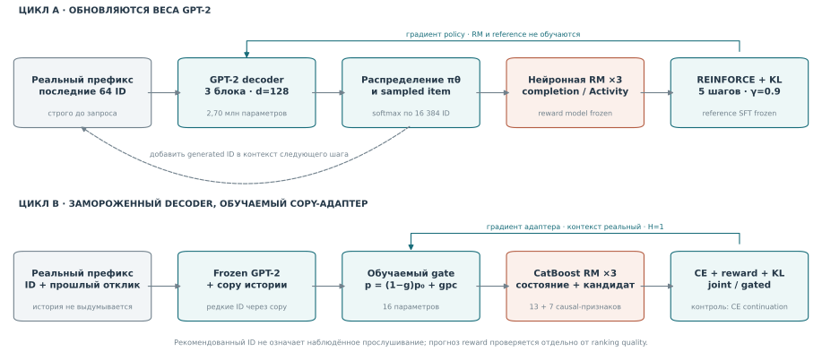

# RL в последовательных рекомендациях

От next-item prediction к оптимизации выученной награды: GPT-2, reward model
и RL. Второй цикл проверяет, помогает ли более точная RM после усиления
supervised baseline.

**[Итоговый отчёт PDF](article.pdf)** · [Архитектура](#архитектура-решения) ·
[Результаты](#результаты) · [Воспроизведение](code/REPRODUCE.md) ·
[CI](https://github.com/YaroslavPelekhov/recsys-rl-study/actions/workflows/checks.yml)

## Задача

По реальной истории пользователя рекомендуем следующий item. Supervised
обучение воспроизводит logged next item; RL направляет policy к высокой
оценке completion или дальнейшей активности. Проверяем, сохраняется ли
релевантность и не использует ли policy ошибки модели отклика.

Рост predicted reward **не равен** измеренному росту удовлетворённости,
retention или времени после интервенции. Это offline исследование в learned surrogate.

## Архитектура решения



### Цикл A: GPT-2 → модель отклика → REINFORCE

**Policy.** GPT-2 обучена с нуля над ID треков: контекст 64, три pre-LN causal
decoder blocks, width 128, четыре attention heads, GELU, MLP expansion 4,
final LayerNorm, tied input/output embeddings. Всего 2,70 млн параметров.
Learned token и position embeddings; текстовые pretrained weights не используются.
Полная softmax — по 16 384 train-only items, остальные ID в контексте — UNK.

**Supervised этап.** Next-item CE обучает SFT policy. После пилота бюджет
увеличен до 12 000 updates; на development выбран checkpoint 3000.
Seeds 42/73 получают те же 3000 updates.

**Neural RM.** Отдельные item embeddings, mean/last history pooling,
embedding кандидата и их произведение, известная длительность и доля
известных ID поступают в MLP `96 → 32 → 2`. Два sigmoid head предсказывают:

1. `completion = clip(played_ratio_pct / 100, 0, 1)`;
2. событие в `[t+1h, t+24h)` — **Activity**.

Activity включает продолжающееся потребление, а не только возврат после ухода.
Три RM seeds образуют ансамбль. Четвёртая audit RM не задаёт reward, но при
общих данных/архитектуре не является независимым oracle.

**RL этап.** Из реального prefix policy сэмплирует пять actions, добавляя ID
в контекст следующего шага. REINFORCE использует discounted returns,
`γ=0.9`, leave-one-out baseline и KL к frozen SFT reference. Обновляются
веса policy; RM и reference заморожены. Playback labels для generated IDs
не выдумываются.

Проверены Ratio, Seconds, Activity, Ensemble и Anchored. Ensemble:
mean − 0,5 std трёх RM. Anchored дополнительно штрафует расхождение RM
между дополненной и начальной реальной историей. Это проверяемая эвристика,
а не калиброванная confidence bound. Search: 5 rewards × 3 KL beta,
по 120 updates на trial; все точки опубликованы.

### Цикл B: frozen GPT-2 + copy → сильная RM → joint/gated

Второй цикл сохраняет decoder и обучает компактный адаптер:

```text
p(item | h) = (1 − g(h)) · p_GPT2(item | h) + g(h) · p_copy(item | h)
```

Copy распределяет массу по последним 64 реальным событиям; повторные позиции
одного item суммируются. Можно вернуть tail item вне head-словаря, если он
наблюдался в train-каталоге. Tail вне последнего контекста недостижим.

**16 параметров:** 13 весов состояния и bias для sigmoid gate, recency decay
и вес прошлого completion для copy. Decoder заморожен. После CE-обучения
сравниваются одинаковые дополнительные бюджеты: CE continuation,
reward-only, uniform joint и gated joint.

**CatBoost RM ×3.** 13 признаков состояния пользователя и 7 признаков
кандидата: прошлые completion/пропуски, частоты, давность, длительность и
исторические связи. Item aggregates фиксируются до day 200; train — 200–259,
calibration — 260–269. Глубина 6 выбрана из 4/6 только по calibration.
Текущий target/outcome не входит в признаки.

**Objective:** CE + reward + KL к CE-адаптеру. Ожидание по copy точное,
по frozen head — 8 MC samples/context. Для конечной смеси градиент reward
доступен напрямую. Это **H1 contextual-bandit адаптация**, не full-decoder H5 RL.

**Gated:** reward term допускается, если три RM согласны о знаке
`E[reward | copy] − E[reward | GPT-2]`. Критерий не читает logged target;
он отличается от target/distractor admission в AdaGRPO и не объявляется
новым общим RL-алгоритмом.

## Данные и защита от утечек

| | Цикл A | Цикл B |
| --- | --- | --- |
| Источник | Pinned Yambda flat/50m/listens | Тот же источник |
| Сохранённые строки | 5 736 029 для 1200 UID | 5 130 518 для 1000 новых UID |
| Внешняя когорта | 400 UID; активны 266, 2770 queries | 1000 UID вне прежних; активны 637, 6393 queries |
| Обучение | Истории до day 270 | Прежние train UID до day 270; новые UID не обучают модели |
| Выбор настроек | Development UID, days 280–286 | Только прежний development |
| Test | Days 293–298 | Тот же период, другие UID |

Query — первые до четырёх nonorganic listens с уникальным timestamp/user-day.
История строго раньше запроса. Будущие targets не добавляются в каталог,
OOV/misses дают ноль. Внутри сравнения запросы и разрешённый train-каталог
общие; ограниченная модельная поддержка показана отдельно. Исторические
outcomes считаются доступными по timestamp лога; задержки неизвестны.

Новая user-когорта того же периода не является будущей временной репликацией.
Метрики усредняются по seeds и пользователям; CI пересэмплирует пользователей
целиком. Рецепты и forecasts фиксируются **до** открытия соответствующих labels.

## Результаты

Основная ranking-метрика — user-macro NDCG@10. В таблице парные 95% CI
по пользователям после усреднения seeds; это не интервал по новым обучениям.

| Контраст | Измеренный эффект |
| --- | --- |
| A: Anchored − Ensemble | Δ NDCG −0,000037; 95% CI [−0,000571; +0,000497] — преимущество не подтверждено |
| B: Copy + CE continuation против GPT-2 | 0,010095 → 0,012977; +28,5%, CI разности [+0,001290; +0,004613] |
| B: Gated joint − CE continuation | Δ −0,000096; CI [−0,000162; −0,000037] — небольшое ухудшение |
| B: RM на одних logged actions | MSE старой сети 0,184392, новой RM 0,059784 |

Прирост baseline не приписывается RL. Победа над repeat не установлена.
State-only RM имеет MSE 0,063096; ошибки трёх full RM коррелируют около 0,998.
Их согласие не стало независимым свидетельством правильности reward.
Все trials и разбор поведения: [цикл A](code/reports/task2/REPORT.md),
[цикл B](code/reports/task2b/REPORT.md).

## Где это реализовано

| Компонент | Код |
| --- | --- |
| Sampling, causal prefix, train-only словарь | [task2_data.py](code/src/rec/task2_data.py) |
| GPT-2, neural RM, REINFORCE и rewards | [task2_models.py](code/src/rec/task2_models.py) |
| Train/search/freeze A | [research_task2.py](code/scripts/research_task2.py) |
| Признаки сильной RM, full-ID история | [task2b.py](code/src/rec/task2b.py) |
| Copy mixture и joint/gated objective | [research_task2b.py](code/scripts/research_task2b.py) |
| Forecasts до labels, внешняя оценка | [evaluate_task2.py](code/scripts/evaluate_task2.py), [evaluate_task2b.py](code/scripts/evaluate_task2b.py) |
| Независимый пересчёт | [verify_submission.py](code/scripts/verify_submission.py), [verify_task2.py](code/scripts/verify_task2.py), [verify_task2b.py](code/scripts/verify_task2b.py) |

## Быстрая проверка

```powershell
cd code
uv sync --locked --extra dev --python 3.11.9
uv run --locked python scripts/verify_submission.py
uv run --locked pytest -q
```

Пересчитываются 27 и 24 массива raw top10, ranking, интервалы, RM errors и
rollout checks. Yambda, веса и GPU не нужны. Нейронный unit test требует
extra `neural` и пропускается в core environment. Полное обучение и tested
CUDA build — в [REPRODUCE.md](code/REPRODUCE.md).

## Материалы и ограничения

[LaTeX](code/paper/submission_task2/article.tex) · [Overleaf ZIP](latex.zip) ·
[Протокол A](code/docs/TASK2_PROTOCOL.md) · [Протокол B](code/docs/TASK2B_PROTOCOL.md) ·
[Литература](code/docs/TASK2_LITERATURE.md)

Исторические статьи сохранены в `code/paper/task2*`; главный отчёт —
`article.pdf` в корне. Из прежней работы включены только UID manifests v3/v4
для проверки непересечения. Сырые данные, веса и окружения не включены.
Нет online A/B, impression propensities и контрфактуальных labels.
Все tests открыты; новый подбор требует новой внешней проверки.
