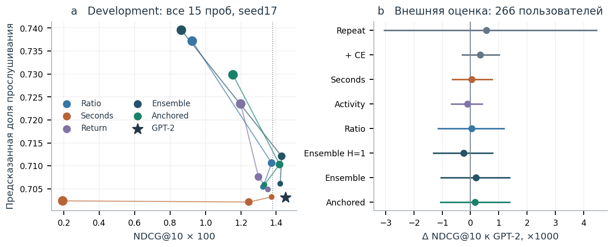
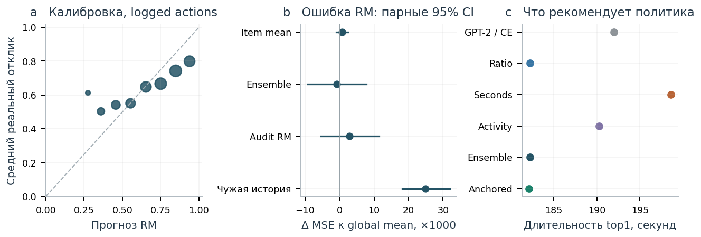
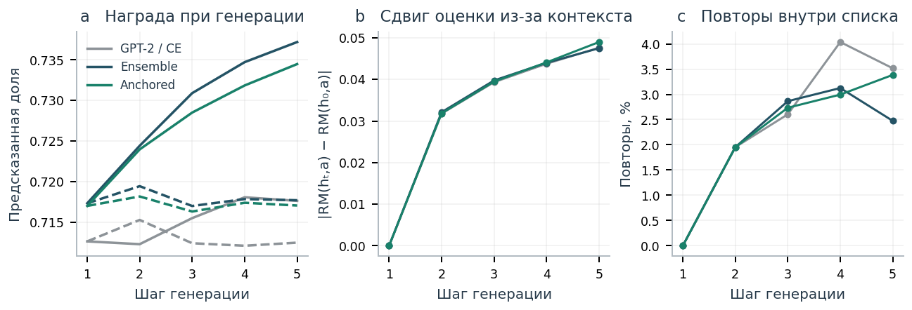

# RL-донастройка GPT-2: что стало лучше на самом деле

Обучена последовательная модель над ID треков, четыре модели отклика и RL-варианты с пятью наградами. Исследование включает development-пилот, расширение обучения baseline, полный поиск, внешний тест и разбор пятишаговой генерации.

Главный результат отрицательный: предложенный штраф за вымышленную историю **не подтвердил преимущество** над обычной ансамблевой наградой. Разность NDCG@10 **−0.000037**, 95% user-cluster CI **[−0.000571; +0.000497]**. Это не доказательство эквивалентности. Ни один выбранный RL-вариант не подтвердил прирост NDCG относительно GPT-2.

При этом RL изменяет поведение. У Ensemble предсказанная ratio top1 выросла с **0.7143 до 0.7242**, а средняя длительность выдачи уменьшилась с **192 до 182 секунд**. На development оптимизация времени со слабым KL привела к одному треку в **51.3% top1** и потере точности. Эта конфигурация не выбрана по заранее заданному правилу; на внешнем тесте у выбранных политик полной унификации выдачи нет.



## Что проверено

Новые1200 пользователей не пересекаются с когортами v3/v4. Сохранены все **5,736,029** исходных строк listens, без обрезания историй. Все models/statistics обучены до day270. Development: days280–286,800 UID; внешний тест: days293–298,400 других UID. Из них активны266 пользователей,2770 оценочных запросов. Ранние истории external UID доступны обучению. Это временной holdout с отдельными пользователями для оценки, не независимая репликация на новом будущем периоде.

Задача — следующий неорганический listen, первые до4 событий с уникальным timestamp за user-day. Один общий train-only каталог16384 треков; **47.4%** внешних целей вне словаря остаются промахами. Все источники пропущенных целей сохраняются в знаменателях. Повторы разрешены, targets не добавляются в кандидаты.

Модель: GPT-2 с нуля,3 decoder blocks, width128,4 heads, context64,2.70 млн параметров. После development-пилота увеличен бюджет SFT; выбран checkpoint3000 из12000 updates. Сравниваются popularity, repeat, Markov, продолжение CE и RL: Ratio, Seconds, Activity, Ensemble, Anchored; у Ensemble также H=1. Три отдельных policy seeds17/42/73, один фиксированный ансамбль RM. Правило выбора beta и главный контраст зафиксированы до test.

## Оригинальная гипотеза

Ансамблевая награда: средняя предсказанная ratio минус половина std трёх RM. Предложенная модификация дополнительно вычитает абсолютное расхождение оценки одного кандидата в дополненной и начальной реальной истории. На первом шаге штраф равен нулю. Основное сравнение использует одинаковые beta0.1, число updates и длину rollout. Это проверяемая конструкция, без заявления мирового приоритета и теоретической гарантии.

## Почему рост reward недостаточен

RM обучаются только на реально наблюдавшихся listens; неизвестным откликам на непрослушанные items не присваивается0. На внешних logged actions ratio MSE ансамбля **0.1798**, глобального среднего — **0.1806**; надёжное улучшение не установлено. Подмена контекста чужой ранее доступной историей повышает MSE до **0.2056**. История важна, но RM остаётся слабым оптимизационным ориентиром. Activity AUC **0.568**, Brier хуже константы; это сигнал активности через1–24h, не causal retention.



На пяти шагах Ensemble повышает оценку примерно с **0.717 до0.737**, когда собственные рекомендации добавляются в историю; при замороженной истории она остаётся около **0.718**. Пользовательских откликов при этом нет. Anchored не устранил сдвиг. Четвёртая audit RM тоже не является oracle: другая инициализация при общих данных не устраняет shared bias.



## Проверка и границы вывода

Сохранение всех исходных строк подтверждено SHA канонических строк; пользователи не пересекаются с прежними работами. Все24 neural top10 forecasts воспроизведены точно.64 проверки замены будущих событий сохранили входной контекст.27 массивов прогнозов, ranking-метрики, все seeds, RM errors и главный bootstrap пересчитываются без Yambda и GPU.

Не измерены удовлетворённость, реальное время после интервенции или удержание. Нет impression propensities, IPS/DR оценки, online A/B, нового внешнего сервиса. Статистическая мощность ограничена266 активными пользователями. H1/H5 имеют одинаковое число updates, но разное число sampled actions. Joint NLL+RL и более сильная RM — недостающие контроли. Старые метрики первой задачи относятся к другой постановке и напрямую несопоставимы.

**Этот test открыт. Новые настройки по его результатам выбирать нельзя.** Продолжение требует нового внешнего периода/датасета или заранее зарезервированной проверки.

## Артефакты

- [Статья PDF](../../output/pdf/task2-rl-paper.pdf), [LaTeX](../../paper/task2/article.tex).
- [Все таблицы,15 trials и model seeds](RESULTS.md).
- [Протокол](../../docs/TASK2_PROTOCOL.md), [поправка после пилота](../../docs/TASK2_AMENDMENT_01.md), [литература](../../docs/TASK2_LITERATURE.md).
- [Воспроизведение](../../docs/TASK2_REPRODUCE.md), [данные графиков](evidence/figure_data.json), [audit](evidence/audit.json).

```powershell
uv run --locked python scripts/verify_task2.py
```
