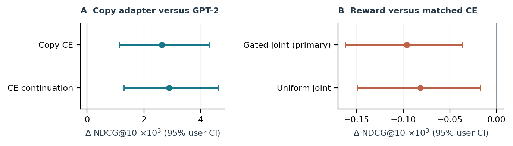
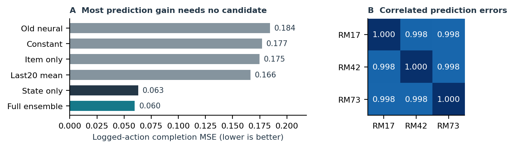

# Более точная reward model не гарантировала полезную RL-донастройку

Второй цикл задачи 2 устраняет две слабости первого: ограниченную поддержку
словаря и неточную модель отклика. Проверка выполнена на **1000 заранее
зарезервированных новых UID**; активны637, получено6393 запроса. Это другие
пользователи того же периода Yambda, не новая временная репликация.

**Подтвердился прирост улучшенного supervised baseline, а не RL.** GPT-2 с
обучаемым copy-адаптером и дополнительным CE получил NDCG@10 **0,012977**
против **0,010095** у замороженного GPT-2: +28,5%, абсолютная разность
0,002882, 95% user-cluster CI **[0,001290; 0,004613]**. Сам copy CE до
продолжения:0,012731, +26,1%, CI разности с GPT-2 [0,001140;0,004289].
Это контрольные интервалы, не несколько независимых основных гипотез.

Главное заранее выбранное сравнение — gated joint против продолжения CE —
дало **−0,000096**, CI **[−0,000162;−0,000037]**. Прибавка reward к той же
модели снизила NDCG примерно на0,74%. Снижение небольшое по величине, но
интервал исключает0. У uniform joint результат сходный:−0,000081.
Победа над repeat также не установлена: CE−repeat0,000994,
CI [−0,001616;0,003283].



## Что изменилось и что проверяет идея

Исходный GPT-2 имеет16384 item-токена. Новый адаптер смешивает его frozen
распределение с копированием из последних64 реальных событий. Позиции одного
трека суммируются; копировать можно только item из train-каталога270376.
Gate зависит от13 признаков реального префикса; copy имеет обучаемые recency
и вес прошлого отклика. Всего **16 обучаемых параметров**, decoder не меняется.
Copy/repeat-explore — известное семейство, см.
[Pointer Sentinel](https://arxiv.org/abs/1609.07843) и
[RepeatNet](https://arxiv.org/abs/1812.02646).

RM теперь CatBoost на состоянии пользователя и связи с кандидатом: прошлые
доли прослушивания, частота/давность кандидата в истории, train-only статистики
и длительность. Текущий outcome не является входом. Item aggregates
фиксируются до day200; RM train —200–259, calibration —260–269. Две глубины
выбираются на calibration; используются три RM seeds. Decoder и все модели
первого Task2 сохранены без изменений.

Проверяемая модификация: совместный CE+reward допускает reward term, когда
все три RM согласны о знаке ожидаемого преимущества copy над GPT-2. Это
более узкий критерий, чем объявление RM «достаточно точной» в среднем.
Он не использует текущий target. Сравниваются CE continuation, reward-only,
uniform joint и gated joint при одинаковом бюджете. На development
gated допускает около88,5% примеров. Все12 reward trials seed17 опубликованы.

Селективная NLL+RL оптимизация уже исследуется, например в
[AdaGRPO](https://arxiv.org/abs/2606.08480). Мы не воспроизводим AdaGRPO:
там gate зависит от рангов target/distractors, здесь — от согласия RM о
разнице двух ветвей. Наш вклад — конкретный проверенный критерий и его
отрицательный результат, а не заявление нового общего RL-алгоритма.

## Почему точная RM не решила задачу

На новых UID MSE ансамбля **0,059784**, старой neural RM **0,184392**,
константы на той же RM train-популяции **0,176966**. CI разности с константой
**[−0,124936;−0,109805]**. Это сильное подтверждённое улучшение прогнозирования
наблюдавшегося отклика.

Но RM только с состоянием пользователя, вообще без кандидата, имеет MSE
**0,063096**. Полная модель точнее: CI разности [−0,004046;−0,002591], хотя
это контроль одной state-only модели против ансамбля трёх полных моделей,
а не идеально уравненная ансамблевая абляция. Одна state-only модель уже
достигает примерно97% уменьшения MSE ансамбля относительно константы.
Большая часть прогнозируемости не помогает выбирать между треками.

Ошибки трёх полных RM коррелируют около**0,998**. Совпадение их оценок не
является независимым подтверждением правильности. Это согласуется с
неудачей admission gate, но не доказывает единственную причину снижения NDCG.



У gated top1 proxy reward0,618582 против0,618404 у CE; NDCG ниже. Popularity
получает ещё более высокую proxy0,648050 при NDCG0,003370. Эти числа —
прогноз RM на выбранных действиях, не измеренный эффект рекомендации.

Описательный аудит после test исправляет вторичную статистику длительности: исходный кэш использовал метаданные до day200 с unknown=0. У CE это13,2% top1 в user-macro усреднении. По длительностям, известным к train cutoff270, среднее CE189,2с, gated189,1с. Ranking, RM, кандидаты и политики не менялись; исходный кэш сохранён. [Пересчитываемый аудит](evidence/descriptive.json).

## Протокол и ограничения

Обучение — исходные1200 UID Task2 до day270; development — прежние800 UID,
days280–286. Новая внешняя когорта seed161803 исключает v3/v4 и все UID
первого Task2. Сохранены все5130518 её строк; SHA канонических значений
всех шести колонок совпадает с отбором из источника.62 future-mutation
проверки сохраняют признаки. Метки открыты после фиксации24 массивов top10.

Все методы оцениваются на общем train-каталоге; будущие positives не
добавляются. Полный каталог содержит80,7% целей, head —48,6%, достижимая
поддержка head+copy —49,9%. **Copy не решил весь OOV**: редкий item вне
последних64 событий остаётся недостижимым. Все пропущенные цели дают0.

Baseline обучен ранее; дополнительный цикл содержит24 fits адаптера,
4 RM search fits и2 диагностические RM. Записано30,5с адаптеров,27,2с
кэшей и6,3с основного RM поиска; это инкрементальные времена этапов на
RTX4070TiSUPER/i7-14700KF, без подготовки, неудачных запусков, абляций,
прежнего GPT-2 обучения и полного wall time исследования.

Были технические сбои подготовки/host commit/памяти fallback. До открытия
labels исправлено выделение списка всего каталога: первые20 popular items
точно достаточны для заполнения top10 после максимум10 исключений.
Все22 ранее рассчитанных forecasts остались побайтно идентичными. Первые
freeze и код, описание исправления и контроль хешей сохранены в evidence.

Исторические outcomes считаются доступными по timestamp лога; реальных
задержек доставки нет. Нельзя переносить вывод на систему с другими задержками.
Новая RM использует более богатую информацию, поэтому это не сравнение только
архитектур RM. Copy-контекст ограничен64, baseline GPT-2 не переобучается.
RL здесь H1 contextual-bandit адаптация: ожидание по copy точное, по frozen
head —8 MC samples/context. Это не full-decoder H5 REINFORCE и не оценка
реального долгосрочного эффекта. Пятишаговый эксперимент первого Task2
остаётся [отдельным результатом](../task2/REPORT.md).

**Новый test теперь открыт. Настройки по нему больше не выбираются.** Для
следующего подтверждения нужен иной период/датасет или заранее выделенная
новая когорта с честным указанием её ограничений.

## Проверка и материалы

- [Полный поиск и таблицы](RESULTS.md), [протокол](../../docs/TASK2B_PROTOCOL.md).
- [Воспроизведение](../../docs/TASK2B_REPRODUCE.md), [числа и исходные прогнозы](evidence/results.json).
- [Статья LaTeX](../../paper/task2b/article.tex), [PDF](../../output/pdf/task2-research-paper.pdf).

```powershell
uv run --locked python scripts/verify_task2b.py
```

Verifier пересчитывает все ranking-метрики, интервалы, RM MSE и coverage по
компактным прогнозам без Yambda, моделей и GPU. Он также проверяет цепочку
freeze → forecast seal → labels, исходный код и отсутствие фильтрации промахов.
